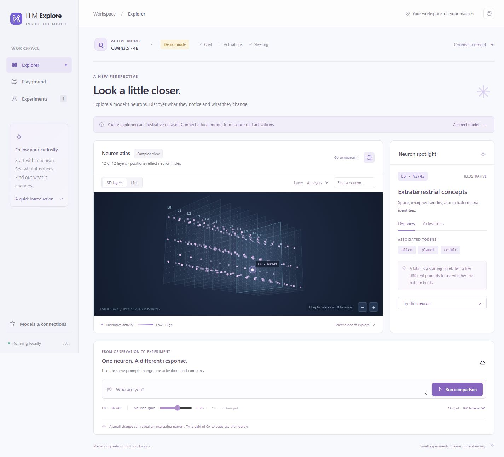

# LLM Explore

A simpler, local workspace for understanding language models: choose a model, inspect a neuron, and compare what changes when you scale its activation.



Rebuilt from the supplied `neuron-explorer` research app. The original source on your Desktop is untouched. This repository is a fresh implementation, rather than a reskin of its Qwen-specific runtime.

## Run

Python 3.11 or newer. The demo and HTTP providers need **no third-party packages**:

```powershell
python -m explorer
```

Open **http://127.0.0.1:8791**. To use another port or data directory:

```powershell
python -m explorer --port 8792 --data-dir ./my-workspace
```

### Local model inference

Install the optional inference dependencies:

```powershell
uv sync --extra local
uv run python -m explorer
# Or: python -m pip install -e ".[local]"
```

In **Models & connections**, add a Hugging Face model ID or a local model directory. Start with a small dense model that fits your hardware, such as `Qwen/Qwen3-0.6B`. Select the connection to load it; first use downloads weights. Gated models require normal Hugging Face authentication. Custom remote model code is disabled. CPU, CUDA, and MPS are detected automatically; the complete model must fit available memory.

Architecture paths are discovered from the loaded model, not inferred from a model name. The adapter recognizes dense output projections used by Llama, Qwen, Mistral, Gemma, Phi, GPT-2, GPT-NeoX, and OPT-style decoder stacks. Recognition is structural; it is not a promise that every model variant has been validated. Unsupported or MoE architectures return a clear error. Add a layer path or output-projection path in `explorer/local.py` to extend dense model support.

Multimodal models with a text configuration use the Transformers image-text auto loader, but this workspace accepts text only. Local models use their tokenizer's chat template when present. Plain base models receive the raw prompt.

### Chat APIs

Add one of these providers in **Models & connections**:

| Provider          | Base URL example           | Model ID                               |
| ----------------- | -------------------------- | -------------------------------------- |
| Ollama            | `http://localhost:11434`   | An installed model, e.g. `llama3.2:3b` |
| OpenAI-compatible | `http://localhost:8000/v1` | The model ID served by your endpoint   |

For authenticated endpoints, set an environment variable **before starting the server**:

```powershell
$env:LLM_API_KEY = "your-key"
python -m explorer
```

Enter `LLM_API_KEY` in the connection's **API key environment variable** field. Only the variable name is stored. The compatible adapter expects `/chat/completions` with `messages`, `max_tokens`, and `temperature`; provider-specific extensions are not implemented. Ollama uses `/api/chat` with non-streamed responses. Prompts are sent to the endpoint you configure. API providers support chat, not neuron inspection or steering.

## The workspace

- **Explorer:** an interactive 3D layer stack; a focused neuron panel; signed per-token activation inspection; and baseline versus steered generation. Drag to orbit, scroll or use +/− to zoom, and click a neuron. Arrow keys select neurons; R resets the camera. List view offers a keyboard-friendly alternative.
- **Playground:** independent single-turn prompts with the active provider.
- **Experiments:** comparisons are saved automatically, with their model, prompt, gain, provenance, and both outputs. Export individually or together as JSON, or delete them.
- **Models & connections:** reusable provider profiles with explicit capability badges.

The default **demo mode is synthetic**. Its neuron labels, activity, and response examples demonstrate the interaction; they are not scientific measurements. Live models start with unnamed neurons. Atlas coordinates are determined by layer and neuron index, not embeddings or measured connections. All-layer views sample at most 12 layers and 19 neurons per layer. Filtering a specific layer works across the full architecture; search filters the displayed sample. **Go to neuron** opens any valid layer and neuron index, including those outside the sample.

**Neuron gain** scales the input of the MLP output projection: `activation[..., neuron] *= gain`. A gain of **1×** leaves it unchanged, **0×** suppresses it, and **2×** doubles it. The intervention applies to all prompt and generation positions. Both responses use the same prompt and greedy decoding. This gain is not the original app's residual-normalized additive dose. Activations are raw signed values from one selected MLP neuron. Context is limited to 2,048 input tokens and output to 512 tokens per response. Requests run synchronously; local models may be slow on CPU. Browser requests do not cancel an ongoing backend inference.

## Implementation

```text
explorer/
  server.py       Local HTTP routes, validation, same-origin guard
  providers.py    Provider contract, synthetic demo, chat APIs, sampled atlas
  local.py        Lazy Transformers loading, architecture discovery, temporary hooks
  store.py        SQLite profiles and experiment history
  static/         Responsive HTML, CSS, and browser JavaScript
tests/            HTTP integration, persistence, adapter and hook tests
```

The server binds to loopback and rejects foreign Host/Origin headers. It serves a fixed asset allowlist and has no shell, agent process, upload handler, third-party frontend scripts, or build step. Data defaults to `./data/explore.sqlite3` (ignored by Git). Set `LLM_EXPLORE_DATA` or use `--data-dir` to relocate it. Data is model-scoped and never reuses the original Qwen caches for another model. One local model is retained at a time. The experiment list/export is bounded to the 200 most recent saved comparisons; older records remain in SQLite.

The rebuild retains the 3D layer view with a small, dependency-free perspective renderer. It removes UMAP, the cache-dependent circuit browser, sweep orchestration, and Claude CLI/MCP assistant. The research notes were treated as background context, not operating instructions. See [docs/rebuild.md](docs/rebuild.md) for the rationale and extension points.

## Verify

```powershell
python -m unittest discover -s tests -v
node --check explorer/static/app.js
```

Core tests do not need model downloads or a GPU. Optional Torch hook tests run when Torch is installed. Live model/hardware compatibility should be checked with your actual weights before treating outputs as research evidence.

Provider references: [Transformers auto classes](https://huggingface.co/docs/transformers/en/model_doc/auto), [chat templates](https://huggingface.co/docs/transformers/en/chat_templating), and [Ollama chat API](https://docs.ollama.com/api/chat).
